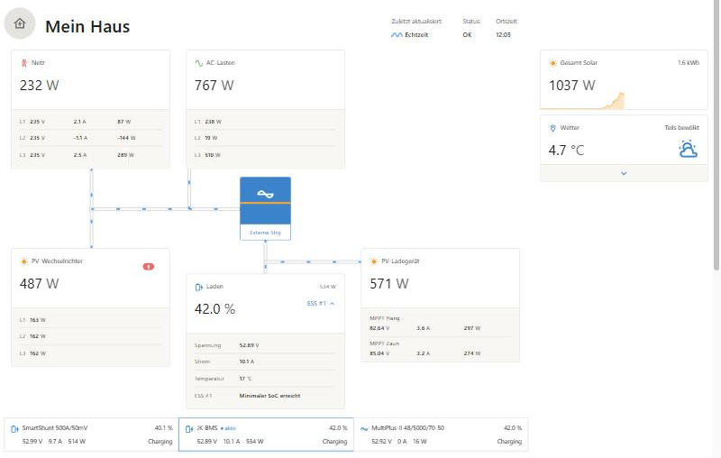
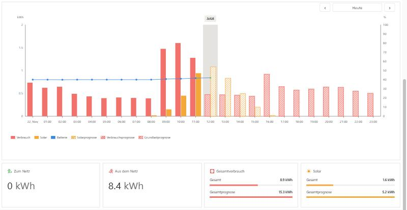
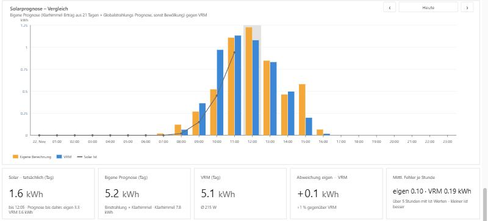
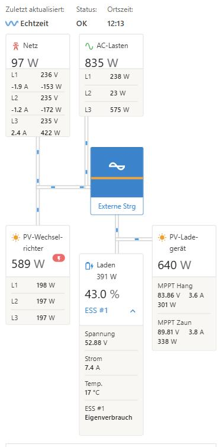
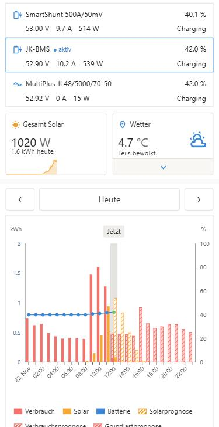

# VRM goes HA

[🇬🇧 English](README.md)

Das Aussehen des **Victron-VRM-Portals** in Home Assistant – eine Integration mit zwei Teilen:

- **VRM-Style-Karten**: Energiefluss-Übersicht, Diagramm für Verbrauch, Solar und Batterie mit Prognosen sowie ein
  Vergleich der eigenen Prognose mit der VRM-Prognose. Jedes Gerät ist einstellbar: beliebig viele Netzphasen,
  PV-Wechselrichter, Laderegler und Batteriewächter. Die Karten funktionieren mit beliebigen Sensoren, nicht nur mit Victron.
- **VRM-Prognose-Sensoren**: die stündliche Prognose aus dem VRM-Portal (Verbrauch, Grundlast, Wallbox, Wärmepumpe,
  Solar – heute und morgen), eingerichtet über die Oberfläche mit dem VRM-Zugriffstoken.

Die Integration lädt die Karten automatisch auf jedem Dashboard – keine Ressource eintragen, kein zweites Repository.

> Inoffizielles Projekt, nicht mit Victron Energy verbunden und nicht von Victron Energy unterstützt. „Victron“,
> „Victron Energy“ und „VRM“ sind Marken bzw. Namen der Victron Energy B.V. und werden hier nur verwendet, um die
> Kompatibilität zu beschreiben.







<p>
  
  
</p>

## Funktionen

- **Übersicht**: Netz, AC-Lasten, Wechselrichter/Lader, AC-gekoppelte PV-Wechselrichter, DC-Laderegler (MPPT),
  Batterie, Batteriewächter, Gesamt Solar mit Tagesverlauf und Wetter mit 5-Tage-Vorhersage. Animierte Flusslinien und
  animiertes „Echtzeit“-Symbol wie bei VRM.
- **Flexibel**: Kästen und Zeilen passen sich an (1 oder 3 Phasen, 1 oder 10 MPPT, 0–n Batteriewächter …); was nicht
  eingestellt ist, wird ausgeblendet.
- **Aktiver Batteriewächter** (z. B. BMS oder SmartShunt) wird automatisch erkannt.
- **Diagramm**: Verbrauch, Solar, Ladestand, Prognosen (schraffiert) für Stunden, Tage, Wochen, Monate. Zeitraum-Auswahl
  wie bei VRM: Schnellauswahl, eigener Zeitraum, Vergangenheit und bis 10 Tage in die Zukunft.
- **Eigene Prognosen**: Verbrauch (Mittel der letzten 7 Tage), Grundlast (Median, ohne Wallbox/Wärmepumpe),
  Solar (Klarhimmel-Ertrag der letzten 21 Tage × Einstrahlungs- oder Bewölkungsprognose, kalibriert sich selbst).
- **Vergleichskarte**: eigene Prognose gegen VRM-Prognose (oder eine andere) gegen Ist – je Stunde und Tag, mit mittlerem Fehler.
- **Prognose-Archiv** (optional): speichert die Prognose jedes Tages, damit vergangene Tage mit der damaligen Prognose verglichen werden.
- Deutsch und Englisch, hell und dunkel, eigenes Handy-Layout.
- **VRM-Prognose-Sensoren**: Verbrauch, Grundlast und Solar für heute, morgen, die laufende und die nächste Stunde,
  dazu eine Stundenliste für die Diagramme.

## Installation

Direkt in Home Assistant öffnen (HACS nötig):

[](https://my.home-assistant.io/redirect/hacs_repository/?owner=Xander2980&repository=vrm-goes-ha&category=integration)

1. **VRM goes HA** in HACS installieren (oder: HACS → ⋮ → *Benutzerdefinierte Repositories* →
   `https://github.com/Xander2980/vrm-goes-ha`, Typ **Integration**).
2. Home Assistant neu starten.
3. Integration einrichten:

   [](https://my.home-assistant.io/redirect/config_flow_start/?domain=vrm_forecast)

4. Browser neu laden (Strg+F5 bzw. in der App nach unten ziehen). Die Karten stehen jetzt im Dashboard-Editor zur Auswahl.

**Von Hand:** `custom_components/vrm_forecast` nach `/config/custom_components/` kopieren und Home Assistant neu starten.

**Nur die Karten, ohne VRM-Konto:** Die Karten werden von der Integration geladen und brauchen sie daher eingerichtet.
Ohne VRM-Zugriffstoken `custom_components/vrm_forecast/frontend/vrm-style-cards.js` nach `/config/www/` kopieren und
unter Einstellungen → Dashboards → ⋮ → *Ressourcen* `/local/vrm-style-cards.js` als **JavaScript-Modul** hinzufügen.

## Einrichtung der Prognose

1. Im VRM-Portal ein Zugriffstoken erstellen: *Einstellungen → Integrationen → Zugriffstoken*
   (https://vrm.victronenergy.com/access-tokens).
2. Einstellungen → Geräte & Dienste → *Integration hinzufügen* → **VRM goes HA** → Token einfügen.
3. Installation wählen. Fertig – die Sensoren werden alle 15 Minuten aktualisiert (in den Optionen der Integration änderbar).

Das Token speichert Home Assistant wie bei jeder anderen Integration (in `.storage`), nicht in YAML.

**Token ändern:** Einstellungen → Geräte & Dienste → **VRM goes HA** → ⋮ → *Neu konfigurieren* → neues Token eingeben.

## Einrichtung im Dashboard-Editor (ohne YAML)

Im Dashboard-Editor die Karte **VRM Style – Dashboard** (oder eine Einzelkarte) hinzufügen. Das Formular hat für jeden
Teil der Anlage einen Abschnitt mit Entitäten-Auswahl und *+ Hinzufügen* / *Entfernen* für Listen. Zwei Knöpfe füllen es
automatisch:

- **Victron GX automatisch erkennen** – übernimmt alle Geräte der Integration *Victron GX* (Netzzähler, PV-Wechselrichter,
  Laderegler, MultiPlus/Quattro, Batterie und Batteriewächter samt Energiezählern).
- **VRM-Prognose-Integration erkennen** – trägt die Sensoren von dieser Integration ein.

Danach prüfen und Wetter sowie (optional) Einstrahlung ergänzen. Alles bleibt auch in YAML bearbeitbar.

## Schnellstart (YAML)

```yaml
type: custom:vrm-dashboard-card
title: Mein Haus
grid:
  power: sensor.netz_leistung
ac_loads:
  power: sensor.ac_lasten
battery:
  soc: sensor.batterie_ladestand
  power: sensor.batterie_leistung
solar_chargers:
  - name: MPPT
    power: sensor.mppt_leistung
energy:
  grid_import: sensor.netz_bezug_energie
  grid_export: sensor.netz_einspeisung_energie
  solar: [sensor.mppt_ertrag_gesamt]
weather: weather.home
```

Die Karte am besten in eine **Panel-Ansicht** (oder einen Abschnitt in voller Breite) legen. Sie passt sich der Breite an
und schaltet unter 700 px auf das Handy-Layout um. Weitere Beispiele: [`cards/examples/`](cards/examples/).

## Karten

| Karte | Inhalt |
|---|---|
| `custom:vrm-dashboard-card` | Alle Karten mit **einer** Konfiguration. `cards:` legt Auswahl und Reihenfolge fest: `overview`, `chart`, `solar_compare`, `baseload_compare`. |
| `custom:vrm-overview-card` | Energiefluss-Übersicht |
| `custom:vrm-chart-card` | Diagramm mit Zeitraum-Auswahl und Tageskacheln |
| `custom:vrm-compare-card` | Prognose-Vergleich, `metric: solar` oder `metric: baseload` |

Alle Karten verstehen dieselben Schlüssel – ein Block kann zwischen ihnen kopiert werden.

## Konfiguration

Die vollständige Liste aller Schlüssel steht in der [englischen Anleitung](README.md#configuration); hier die wichtigsten:

| Schlüssel | Bedeutung |
|---|---|
| `title`, `icon`, `language` (`de`/`en`), `theme` (`light`/`dark`) | Allgemein |
| `grid` | `name`, `power`, `phases` (Liste `{voltage, current, power}`), `invert: true` wenn Bezug negativ ist |
| `ac_loads` | `power` oder `phases` (Liste von Leistungssensoren) |
| `inverter` | `name`, `state` (Text im blauen Kasten), `dc_voltage`, `dc_current`, `dc_power` (+ = Laden) |
| `pv_inverters` | Liste `{name, power, phases}` – AC-gekoppelte PV |
| `solar_chargers` | Liste `{name, power, voltage, current}` – MPPT-Laderegler |
| `battery` | `soc`, `power`, `voltage`, `current`, `temperature`, `state`, `ess_state` |
| `battery_monitors` | Liste `{name, soc, voltage, current, power, time_to_go}` |
| `total_solar`, `weather` | Gesamt-Solarleistung, Wetter-Entität |
| `energy` | Zähler für Diagramm und Vergleich: `grid_import`, `grid_export`, `solar` (Liste), `battery_charge`, `battery_discharge`, `consumption_power`, `exclude_from_baseload` (Liste, z. B. Wallbox und Wärmepumpe), `solar_reference`, `solar_today` |
| `forecast` | `name`, `consumption`/`solar` (`yesterday`, `today`, `tomorrow`, `current_hour`, `next_hour`), `hourly`, `archive`, `irradiance`, `use_energy_dashboard` |

Die Zähler brauchen **Langzeitstatistik** (`state_class: total_increasing`), der Ladestand und `consumption_power`
`state_class: measurement`. `forecast.irradiance` erwartet das Format der **DWD-Integration** (Attribut `data` mit
stündlichen Werten in W/m²).

## Prognose-Sensoren (kWh)

| Sensor | Inhalt |
|---|---|
| Stundenprognose | Zustand = Verbrauch heute; Attribut `hours`: Liste `{t, consumption, baseload, ev, heat_pump, solar}` (t = Stundenbeginn in ms, kWh) für heute und morgen; Attribut `sources`: welche VRM-Reihen benutzt wurden |
| Verbrauch heute / morgen | Summe der stündlichen Verbrauchsprognose |
| Grundlast heute / morgen | Verbrauch − Wallbox − Wärmepumpe |
| Solar heute / morgen | Solarertrags-Prognose |
| Verbrauch / Solar aktuelle und nächste Stunde | Wert der laufenden bzw. nächsten Stunde (wechselt zur vollen Stunde) |

Die Prognose stammt aus der VRM-Statistik *Dynamic ESS* (`stats?type=dynamic_ess&interval=hours`). Gibt es eine angepasste
Prognose (`…_fc_adj`), wird sie genommen. Werte in Wh werden automatisch umgerechnet.

## Zusätze (optional)

- [`cards/packages/vrm_forecast_archive.yaml`](cards/packages/vrm_forecast_archive.yaml): Template-Sensor, der die Prognose jedes Tages speichert (35 Tage).
- [`cards/node-red/vrm-forecast-flow.json`](cards/node-red/vrm-forecast-flow.json): ohne die Integration: Node-RED-Flow, der die stündliche VRM-Prognose (Verbrauch, Grundlast, Solar)
  mit dem Node [victron-vrm-api](https://flows.nodered.org/node/victron-vrm-api) holt und `sensor.vrm_forecast_hours` schreibt.
  Nach dem Import im VRM-Node den eigenen VRM-Zugang und die Installation (Site-ID) wählen, im Sensor-Node den Home-Assistant-Server.

## Fehlersuche

- **Karte nicht gefunden**: Die Integration muss eingerichtet sein (sie lädt die Karten); dann den Browser-Cache leeren (Strg+F5). Bei der JS-Datei von Hand: Ressource unter Einstellungen → Dashboards → Ressourcen prüfen.
- **Diagramm leer**: Die Zähler brauchen Langzeitstatistik (Entwicklerwerkzeuge → Statistik). Neue Sensoren liefern erst nach einer Stunde Werte.
- **Netz-Fluss falsch herum**: `grid: invert: true`.
- **Das Token ist ungültig** – neues Token erstellen; nur das Token kopieren (mit oder ohne vorangestelltes „Token“).
- **Sensoren unbekannt** – VRM hat für diese Installation noch keine Prognose (braucht einige Tage Verlauf).
- **Debug-Log**: `logger: logs: custom_components.vrm_forecast: debug`.

## Entwicklung

- `custom_components/vrm_forecast/` – die Integration (Python). Tests: `python -m pytest` (braucht `pytest-homeassistant-custom-component`).
- `cards/src/` – die Karten (reines JavaScript, keine Abhängigkeiten). `cards/build.sh` fügt die Dateien zu
  `custom_components/vrm_forecast/frontend/vrm-style-cards.js` zusammen, das die Integration ausliefert.

## Lizenz

MIT – siehe [LICENSE](LICENSE).
