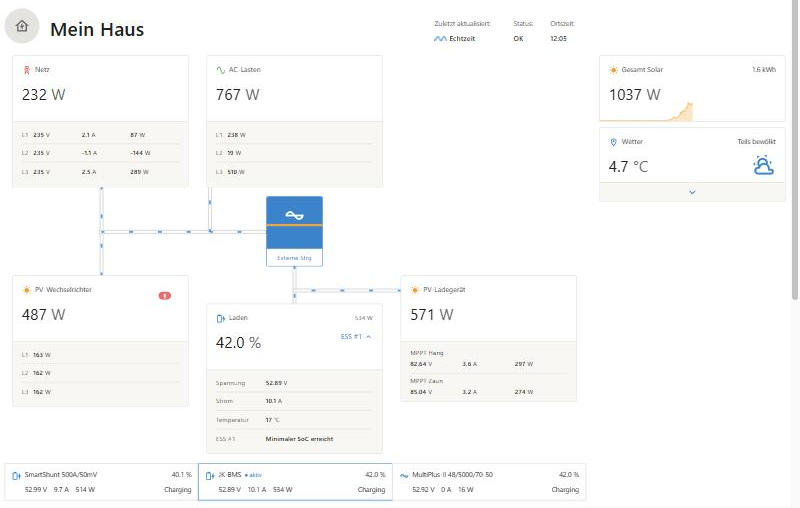

# VRM goes HA

[🇩🇪 Deutsche Anleitung](README.de.md)

The look of the **Victron VRM portal** in Home Assistant – one integration with two parts:

- **VRM style cards**: energy flow overview, consumption / solar / battery chart with forecasts, and a comparison of
  your own forecast with the VRM forecast. Every device is configurable: as many grid phases, PV inverters, solar
  chargers and battery monitors as you have. The cards work with any sensors, not only Victron ones.
- **VRM forecast sensors**: the hourly forecast of the VRM portal (consumption, base load, EV charger, heat pump,
  solar – today and tomorrow), set up in the UI with your VRM access token.

The integration loads the cards on every dashboard automatically – no resource to add, no second repository.

> Unofficial project, not affiliated with or endorsed by Victron Energy. "Victron", "Victron Energy" and "VRM" are
> trademarks or names of Victron Energy B.V. and are only used to describe compatibility.

<!-- Add screenshots to cards/docs/ and link them here, e.g.  -->

## Features

- **Overview**: grid, AC loads, inverter/charger, AC-coupled PV inverters, DC solar chargers (MPPT), battery,
  battery monitors, total solar with today's curve and weather with a 5-day forecast. Animated flow lines and an
  animated "real-time" icon, like VRM.
- **Flexible**: boxes and rows adapt to what you configure (1 or 3 phases, 1 or 10 MPPTs, 0–n battery monitors …);
  missing parts are hidden.
- **Active battery monitor** (e.g. BMS vs. SmartShunt) is detected by comparing it with the system values.
- **Chart**: consumption, solar, battery SoC, forecasts (hatched) for hours, days, weeks, months. Time range picker like
  VRM: quick select, custom range, past and up to 10 days into the future.
- **Own forecasts**: consumption (average of the last 7 days), base load (median, without EV / heat pump),
  solar (clear-sky yield of the last 21 days × irradiance or cloud forecast; self-calibrating).
- **Comparison card**: own forecast vs. VRM (or any other) forecast vs. actual, per hour and per day, with mean error.
- **Forecast archive** (optional): stores the forecast of each day so past days are compared with the forecast as it
  was issued.
- German and English, light and dark theme, separate phone layout.
- **VRM forecast sensors**: consumption, base load and solar for today, tomorrow, the current and the next hour, plus
  an hourly list for the charts.

## Installation

Open directly in Home Assistant (needs HACS):

[](https://my.home-assistant.io/redirect/hacs_repository/?owner=Xander2980&repository=vrm-goes-ha&category=integration)

1. Install **VRM goes HA** in HACS (or: HACS → ⋮ → *Custom repositories* → `https://github.com/Xander2980/vrm-goes-ha`,
   type **Integration**).
2. Restart Home Assistant.
3. Set up the integration:

   [](https://my.home-assistant.io/redirect/config_flow_start/?domain=vrm_forecast)

4. Reload the browser (Ctrl+F5 / pull down in the app). The cards are now available in the dashboard editor.

**Manual:** copy `custom_components/vrm_forecast` to `/config/custom_components/` and restart Home Assistant.

**Only the cards, without a VRM account:** the cards are loaded by the integration, so they need it set up. Without a
VRM access token copy `custom_components/vrm_forecast/frontend/vrm-style-cards.js` to `/config/www/` and add
`/local/vrm-style-cards.js` under Settings → Dashboards → ⋮ → *Resources* as **JavaScript module**.

## Setup of the forecast

1. In the VRM portal create an access token: *Preferences → Integrations → Access tokens*
   (https://vrm.victronenergy.com/access-tokens).
2. Settings → Devices & services → *Add integration* → **VRM goes HA** → paste the token.
3. Choose the installation. Done – the sensors are updated every 15 minutes (changeable in the integration options).

The token is stored like the credentials of every other integration (in `.storage`), not in YAML.

## Setup in the dashboard editor (no YAML)

Add the card **VRM Style – Dashboard** (or one of the single cards) in the dashboard editor. The form has a section
for every part of the system with entity pickers and *+ add* / *remove* for lists. Two buttons fill it automatically:

- **Detect Victron GX automatically** – reads all devices of the *Victron GX* integration (grid meter, PV inverters,
  solar chargers, MultiPlus/Quattro, battery and battery monitors with their energy counters).
- **Detect VRM forecast integration** – adds the sensors of this integration.

Check the result, then add weather and (optionally) irradiance. Everything can still be edited in YAML.

## Quick start (YAML)

```yaml
type: custom:vrm-dashboard-card
title: My house
grid:
  power: sensor.grid_power
ac_loads:
  power: sensor.ac_loads_power
battery:
  soc: sensor.battery_soc
  power: sensor.battery_power
solar_chargers:
  - name: MPPT
    power: sensor.mppt_pv_power
energy:
  grid_import: sensor.grid_energy_import
  grid_export: sensor.grid_energy_export
  solar: [sensor.mppt_yield_total]
weather: weather.home
```

Put the card in a **panel view** (or a section with full width) – it scales to the available width and switches to the
phone layout below 700 px. More examples: [`cards/examples/`](cards/examples/).

## Cards

| Card | Shows |
|---|---|
| `custom:vrm-dashboard-card` | All cards below with **one** configuration. `cards:` chooses which ones and in which order: `overview`, `chart`, `solar_compare`, `baseload_compare`. |
| `custom:vrm-overview-card` | Energy flow overview |
| `custom:vrm-chart-card` | Chart with time range picker and daily tiles |
| `custom:vrm-compare-card` | Forecast comparison, `metric: solar` or `metric: baseload` |

All cards read the same configuration keys, so you can copy one block between them.

## Configuration

Entity ids can always be given as a plain string. Lists may have any length.

### General

| Key | Description |
|---|---|
| `title` | Title of the overview |
| `icon` | Icon next to the title (default `mdi:home-lightning-bolt-outline`) |
| `language` | `de` or `en` (default: Home Assistant language) |
| `theme` | `light` or `dark` (default: Home Assistant theme) |
| `show` | `{ devices: false, weather: false, total_solar: false }` hides parts of the overview |
| `cards`, `gap` | only `vrm-dashboard-card`: list of cards, gap in px |

### Overview

| Key | Fields |
|---|---|
| `grid` | `name`, `power`, `phases` (list of `{voltage, current, power}`, max. 3 shown), `invert: true` if import is negative |
| `ac_loads` | `name`, `power` (optional, otherwise sum of phases), `phases` (list of power sensors or `{power}`) |
| `inverter` | `name`, `state` (text in the blue box), `dc_voltage`, `dc_current`, `dc_power` (+ = charging; sets the flow direction). With `name` and `dc_power` it is also listed at the bottom. |
| `pv_inverters` | list of `{name, power, phases}` – AC-coupled PV. One inverter with phases → one row per phase; several → one row per inverter. |
| `solar_chargers` | list of `{name, power, voltage, current}` – DC-coupled PV (MPPT) |
| `battery` | `soc`, `power`, `voltage`, `current`, `temperature`, `state` (idle/charging/discharging), `ess_state`, `ess_name` |
| `battery_monitors` | list of `{name, soc, voltage, current, power, time_to_go}`. With two or more, the one matching `battery` is marked *active*. |
| `total_solar` | power sensor for the "Total solar" box (otherwise PV inverters + solar chargers) |
| `weather` | weather entity (current condition + daily forecast) |

### Energy (chart and comparisons)

The chart uses Home Assistant **long-term statistics**, so all counters need `state_class: total_increasing`
(or `total`) and an energy unit; the SoC and `consumption_power` need `state_class: measurement`.

| Key | Description |
|---|---|
| `energy.grid_import`, `energy.grid_export` | grid energy counters |
| `energy.solar` | list of solar yield counters (added up) |
| `energy.solar_reference` | optional counter used when one of the `solar` counters has no data for a period |
| `energy.solar_today` | optional daily solar energy for the "Total solar" box |
| `energy.battery_charge`, `energy.battery_discharge` | battery energy counters |
| `energy.consumption_power` | optional power sensor(s) of all consumers (W, a list is added up, e.g. AC loads L1–L3). Consumption = hourly mean, like VRM. Without it consumption = import − export + solar + discharge − charge. |
| `energy.exclude_from_baseload` | list of energy counters (EV charger, heat pump …) that are not part of the base load |
| `battery.soc` | battery SoC line in the chart |

### Forecasts (all optional)

| Key | Description |
|---|---|
| `forecast.name` | label of the external forecast (e.g. `VRM`, `Solcast`) |
| `forecast.consumption` | `yesterday`, `today`, `tomorrow`, `current_hour`, `next_hour` – kWh sensors, e.g. from the *Victron Remote Monitoring* integration |
| `forecast.solar` | `yesterday`, `today`, `tomorrow`, `current_hour` |
| `forecast.use_energy_dashboard` | `false` to ignore the solar forecast configured in the HA energy dashboard (used by default for hourly values) |
| `forecast.hourly` | sensor with attribute `hours: [{t, consumption, baseload, solar}]` (t in ms, kWh) – see [Node-RED flow](cards/node-red/) |
| `forecast.archive` | sensor of the [forecast archive package](cards/packages/) |
| `forecast.irradiance` | global irradiance forecast in the format of the **DWD** integration: attribute `data` = list of `{datetime, value}` in W/m² (value at T = mean of the hour before). Improves the own solar forecast a lot. |

## How the own forecasts work

- **Consumption**: average of the same hour on the previous 7 days, scaled to the external daily forecast if there is one.
- **Base load**: consumption minus `exclude_from_baseload`, **median** of the same hour on the previous 7 days (single peaks do not count).
- **Solar**, per hour, best method first:
  1. *Directly calibrated*: once there are ≥ 5 values per hour of day with measured irradiance: median(yield ÷ irradiance) × forecast irradiance.
  2. *Irradiance × clear sky*: clear-sky yield of your system per hour of day (median of the last 21 days, corrected for clouds) × clearness index (forecast irradiance ÷ clear-sky irradiance, sun position from your HA location).
  3. *Cloud cover*: clear-sky yield × Kasten-Czeplak factor of the weather entity's cloud cover.

For past days the comparison uses the **archived** forecast if the archive package is installed; otherwise it is a
recalculation with the measured weather, and the tile says so.

## Forecast sensors (kWh)

| Sensor | Content |
|---|---|
| Hourly forecast | state = consumption today; attribute `hours`: list of `{t, consumption, baseload, ev, heat_pump, solar}` (t = start of the hour in ms, kWh) for today and tomorrow; attribute `sources`: which VRM series were used |
| Consumption today / tomorrow | sum of the hourly consumption forecast |
| Base load today / tomorrow | consumption − EV charger − heat pump |
| Solar today / tomorrow | solar yield forecast |
| Consumption current / next hour, Solar current / next hour | value of the current or next hour (switches at the full hour) |

The forecast comes from the VRM *Dynamic ESS* statistics (`stats?type=dynamic_ess&interval=hours`). It is available for
installations for which VRM calculates consumption and solar forecasts. If an adjusted forecast (`…_fc_adj`) exists, it
is used. Values in Wh are converted automatically.

## Optional extras

- [`cards/packages/vrm_forecast_archive.yaml`](cards/packages/vrm_forecast_archive.yaml) – template sensor that stores the forecast of every day (35 days).
- [`cards/node-red/vrm-forecast-flow.json`](cards/node-red/vrm-forecast-flow.json) – without the integration: Node-RED flow that reads the hourly VRM forecast (consumption, base load, solar) with
  the [victron-vrm-api](https://flows.nodered.org/node/victron-vrm-api) node and writes `sensor.vrm_forecast_hours`.
  After the import select your VRM API config node, installation (site id) and Home Assistant server.

## Troubleshooting

- **Card not found** – the integration must be set up (it loads the cards); then reload the browser cache (Ctrl+F5). With the manual JS file: check the resource under Settings → Dashboards → Resources.
- **Chart is empty** – the counters need long-term statistics (Developer tools → Statistics). New sensors need one hour for the first values.
- **Values far too high** – counters in Wh are converted automatically; check that each counter only increases.
- **Grid flow in the wrong direction** – `grid: invert: true`.
- **The token is not valid** – create a new token; copy only the token (with or without the word "Token" in front).
- **Sensors are unknown** – VRM has no forecast for this installation yet (it needs some days of history).
- **Debug log**: `logger: logs: custom_components.vrm_forecast: debug`.

## Development

- `custom_components/vrm_forecast/` – the integration (Python). Tests: `python -m pytest` (needs `pytest-homeassistant-custom-component`).
- `cards/src/` – the cards (plain JavaScript, no dependencies). `cards/build.sh` joins the files into
  `custom_components/vrm_forecast/frontend/vrm-style-cards.js`, which the integration serves.
  Texts are written in German in the code and translated in `cards/src/10-i18n.js` – add a language there.

## License

MIT – see [LICENSE](LICENSE).
